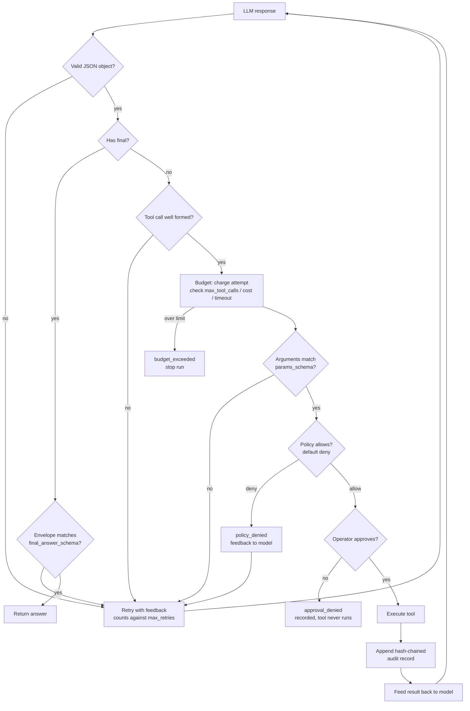

# agent-guardrails

**Guardrails for LLM agents that actually hold. Standard library only.**

Policy engine, schema validation, human-in-the-loop approval, budget ceilings,
and a tamper-evident audit log — wrapping every tool call an LLM agent makes.
No LangChain, no Pydantic, no dependency tree. `pip install` pulls nothing.

The question this repo answers is simple: *what stops an agent from doing
something it shouldn't?* Every control here is a hard gate in code, not a
sentence in a system prompt asking nicely.

---

## The threat model

An agent that can call tools is a program with an LLM deciding its inputs. Three
things go wrong in practice:

1. **It calls something dangerous** — writes outside the workspace, evaluates a
   hostile expression, reaches a domain it was never meant to touch.
2. **It loops.** A retry loop, a confused model, or a tool that keeps failing
   burns tokens and money until something stops it.
3. **You cannot prove what happened.** "The agent deleted the file" is not an
   answer you can take to an auditor.

Each maps to a control here: **policy**, **budgets**, and the **audit chain**.



Notice the ordering: **budget is charged before the policy check.** A call that
is denied still costs an LLM round-trip, so it counts. Otherwise an agent could
loop forever on a denied tool while reporting zero usage — the guardrail would
be decorative. There is a test for exactly this.

---

## Install

```bash
git clone https://github.com/sajjad-rabby/agent-guardrails.git
cd agent-guardrails
python examples/demo_end_to_end.py      # no install, no API key
```

Or:

```bash
pip install -e .
guardrails --help
```

Python 3.9+. Runtime dependencies: none.

---

## The pieces

### Policy — default deny

Rules are JSON. First match wins.

```json
{
  "rules": [
    {
      "name": "safe-arithmetic",
      "tool": "calculator",
      "effect": "allow",
      "reason": "plain arithmetic within length and character limits",
      "conditions": [
        { "arg": "expression", "operator": "matches", "value": "^[0-9+\\-*/(). ]{1,64}$" }
      ]
    },
    {
      "name": "no-shell-metacharacters",
      "tool": "calculator",
      "effect": "deny",
      "reason": "expression contains characters outside the allowlist",
      "conditions": []
    }
  ]
}
```

| Operator | Matches when |
| --- | --- |
| `equals` | the argument equals the value |
| `contains` | the value appears in the argument |
| `starts_with` | the argument begins with the value |
| `matches` | the value is a regex search against the argument |

**A policy with no matching rule denies.** Attaching a policy is opting into
default-deny, so a forgotten rule fails closed. (`policy=None` means no policy
at all, which allows everything — that distinction is deliberate and explicit.)

### Schema validation

A small JSON-schema subset — `type`, `required`, `properties`, `items`, `enum`,
`minLength`, `maxLength`, `pattern`, `minimum`, `maximum` — validating both tool
arguments and the final answer envelope. Errors come back as readable strings
that get fed straight back to the model:

```
Arguments for calculator are invalid: $.expression: string length 0 is less than minLength 1.
```

Booleans are never accepted as numbers, matching JSON Schema semantics.

### Approvals

```python
from agent_guardrails.approvals import CliApprovalHandler

config = AgentConfig(approval_handler=CliApprovalHandler())
```

Any callable implementing `handle(ApprovalRequest) -> ApprovalResult` works:
a Slack approver, a webhook, a queue, or `AutoApproveHandler` for tests. The
agent's tool loop never sees an approval it did not get.

### Budgets

```python
Budget(max_tool_calls=25, max_cost_usd=1.00, timeout_seconds=300.0)
```

`max_steps` additionally bounds assistant turns. Floating-point cost checks use
a small tolerance, so three charges of `0.1` do not trip a `0.3` ceiling through
binary representation error.

### Audit — hash-chained and tamper-evident

Every record commits to the previous one:

```json
{"seq":1,"ts":"2026-01-01T12:00:00Z","event":"tool_call",
 "payload":{"tool":"calculator","args":{"expression":"2+2"}},
 "prev_hash":"000…0","hash":"9f2c…a1"}
```

Editing, deleting, or reordering any record breaks verification:

```python
from agent_guardrails import AuditLog
intact, errors = AuditLog.verify("audit.jsonl")
# intact=False
# ['line 2: hash mismatch (record was modified)']
```

This is a tamper-*evident* log, not a tamper-proof one. Anyone who can write the
file can rewrite the whole chain. It is aimed at the realistic case: proving that
nobody quietly edited history afterwards, and making an edit detectable.

Non-JSON payloads are normalised deterministically — dataclasses become dicts,
enums become values, sets become sorted lists — so logging never crashes the
agent it is recording, and the hash stays reproducible.

---

## CLI

```bash
guardrails policy-check --policy policy.json --tool calculator --args args.json
guardrails validate --schema schema.json --instance payload.json
guardrails verify --path audit.jsonl
guardrails tools --root . --domain example.com
guardrails run --task "..." --responses responses.json --policy policy.json
```

Exit codes: `0` success, `1` denied, `2` invalid input or broken audit chain,
`3` error.

`run` replays a JSON array of canned responses by default, so you can exercise
the whole guardrail path in CI with no API key and no network:

```console
$ guardrails run --task "what is 2+2" --responses responses.json \
      --policy examples/policy.json --root .
{
  "stop_reason": "final_answer",
  "answer": "2 + 2 = 4.",
  "tool_calls": [
    { "tool": "calculator", "allowed": true, "approved": true, "ok": true }
  ]
}
```

For a real model, point it at any OpenAI-compatible endpoint:

```bash
export OPENAI_API_KEY=sk-...
guardrails run --task "..." --llm openai \
    --base-url https://api.openai.com --model gpt-4o-mini --policy policy.json
```

Rate limits (429) and 5xx are retried with backoff; 4xx is not, because
retrying a rejected request just burns quota.

---

## Built-in tools

| Tool | Behaviour |
| --- | --- |
| `calculator` | AST-walked expression evaluator — no `eval`, no names, no attribute access, no calls outside a whitelist |
| `read_file` | confined to declared roots, symlinks resolved before the check |
| `write_file` | same confinement |
| `list_dir` | same confinement |
| `http_get` | hostname allowlist including subdomains, size cap |

The calculator parses the expression and walks the AST against an allowlist of
node types, operators, functions and constants. `__import__('os')`,
`().__class__`, and `open('/etc/passwd')` are rejected at the syntax level
rather than by string matching — so obfuscation does not help.

File confinement resolves symlinks *before* comparing against roots, so a
symlink planted inside the workspace cannot be used to read outside it.

---

## Testing

```bash
python -m pytest tests
```

178 offline tests, no network, no API key. They cover AST-rejection of every
unsafe calculator construct, path traversal and symlink escape, the policy
precedence and default-deny path, approval handlers including EOF and Ctrl-C,
budget ceilings including the floating-point tolerance case, HTTP retry
classification with a stubbed transport, audit-chain tamper detection, and every
CLI subcommand and exit code.

## Project layout

```
agent_guardrails/
  schema.py      JSON-schema subset validator
  tools.py       tool registry, argument validation, built-in toolset
  policy.py      allow/deny rules with conditions
  approvals.py   approval handler protocol, auto and CLI handlers
  budgets.py     tool-call, cost and wall-clock ceilings
  audit.py       hash-chained JSONL log and verification
  llm.py         OpenAI-compatible client, scripted offline double
  agent.py       the guarded execution loop
  cli.py         guardrails entry point
examples/
  demo_end_to_end.py   six scenarios, no API key required
  policy.json, calculator_schema.json, scripted_responses*.json
tests/           178 offline tests
```

## Design notes

**Controls are code, not prompts.** The system prompt *asks* the model to be
careful. Every guardrail here *makes* it. If the model ignores the prompt, the
policy engine still denies the call.

**Default deny, and budget before policy.** Both choices come from the same
place: fail closed, and make the denial path cost something, because a loop of
denials is still a loop.

**Denials are data, not exceptions.** A denied call produces feedback the model
can act on, and a record you can audit. The run continues; only budgets and
limits end it.

**No hidden state.** Policy, budget, approval, and audit objects are explicit
and injectable. The test suite replaces the LLM with a scripted double and the
operator with a lambda.

## License

MIT © 2026 Sajjad Rabby